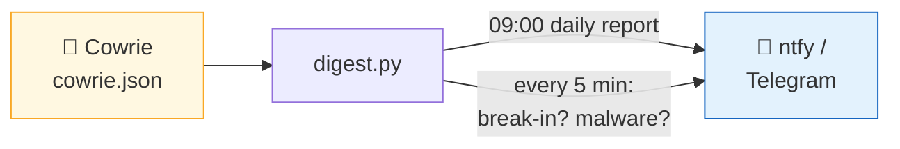

# cowrie-digest

🍯 Your Cowrie honeypot → 📱 your phone. Daily report at 09:00, instant
alerts when someone gets in. Pure Python 3 stdlib — zero dependencies.
Delivers via **ntfy.sh** or **Telegram**.

> **No honeypot yet?** [docs/HONEYPOT-GUIDE.md](docs/HONEYPOT-GUIDE.md) —
> from empty VPS to working trap, step by step, caveman-simple.



## What lands on your phone

**Why:** watching logs by hand = boring, you'll quit in a week. The phone watches for you.

```
🍯 Cowrie digest [srv04] — last 24h

Connections:       312
Failed logins:     1042
Successful logins: 6
Commands run:      89
Files downloaded:  2

Top attackers:
     58x  ip-9f4a2c81e7b3
     41x  ip-2b77c0d4a1f9
```

Plus instant alerts: **someone got a shell** 🚨 or **malware captured** 🦠 —
one consolidated message per run, so a bot storm can't flood your phone.

## Install (2 minutes)

**Why:** honeypot without alerts is a black box. This opens it.

Needs: running Cowrie with `cowrie.json`, Python 3.8+, root.

```bash
git clone https://github.com/W0nIE/cowrie-digest.git
cd cowrie-digest
sudo ./install.sh
sudoedit /opt/cowrie/ops/01-digest/config.env    # pick channel + topic
sudo /opt/cowrie/ops/01-digest/digest.py --digest  # ✅ phone beeps
```

Channel setup (ntfy = easiest, no account):
[docs/CONFIGURATION.md](docs/CONFIGURATION.md).

## Config

**Why:** one file, five variables — the whole setup.

One file: `/opt/cowrie/ops/01-digest/config.env` (mode 0600).

| Variable | Meaning |
|---|---|
| `CHANNEL` | `ntfy` or `telegram` |
| `NTFY_TOPIC` | your secret ntfy topic |
| `TELEGRAM_BOT_TOKEN` / `TELEGRAM_CHAT_ID` | if Telegram |
| `SENSOR_NAME` | label in reports (many honeypots? name them) |
| `DIGEST_HOURS` | report window, default 24 |

## Test / Uninstall

**Why:** test proves it works without a live honeypot. Uninstall leaves zero traces.

```bash
./test.sh           # offline test on a fake attack log — no Cowrie needed
sudo ./uninstall.sh # removes cron + module, touches nothing else
```

## License

**Why:** MIT — take it, change it, no asking.

MIT — see [LICENSE](LICENSE).
