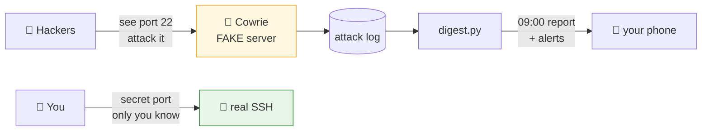
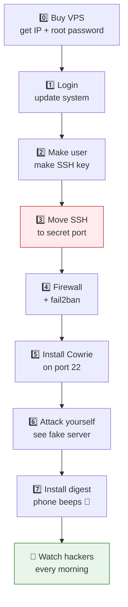

# 🍯 Your Own Honeypot Server — Caveman Guide

> Fake server. Real hackers attack it. You watch. Phone beeps every morning.
> Copy. Paste. Done. ~1 hour.



**The trick:** hackers scan port 22. Your real SSH hides elsewhere.
Port 22 = trap. Trap logs everything.

## The plan



**Before you start — pick two numbers, write them down:**

| Your thing | This guide uses | You use |
|---|---|---|
| Server IP | `203.0.113.10` | ← your real IP |
| Secret SSH port | `51234` | ← yours, 10000–60000 |

⚠️ Never publish your real port. Replace everywhere.

---

## 1️⃣ Login. Update.

On your computer:

```bash
ssh root@203.0.113.10          # password from your VPS provider
```

On the server:

```bash
apt update && apt upgrade -y
apt install -y unattended-upgrades sudo
```

---

## 2️⃣ User. Key. 🔑

Key = unbreakable password. Make key **on your computer**:

```bash
ssh-keygen -t ed25519 -f ~/.ssh/honeypot
cat ~/.ssh/honeypot.pub        # copy the line
```

On the **server** (pick your username instead of `alex`, paste your key):

```bash
useradd -m -s /bin/bash alex && usermod -aG sudo alex
echo 'alex ALL=(ALL) NOPASSWD:ALL' > /etc/sudoers.d/alex && chmod 440 /etc/sudoers.d/alex
mkdir -p /home/alex/.ssh
echo 'PASTE-KEY-HERE' > /home/alex/.ssh/authorized_keys
chmod 700 /home/alex/.ssh && chmod 600 /home/alex/.ssh/authorized_keys
chown -R alex:alex /home/alex/.ssh
```

✅ **Test** — new tab, old tab stays open:

```bash
ssh -i ~/.ssh/honeypot alex@203.0.113.10 'sudo whoami'   # must say: root
```

Works? Go on. Fails? Fix now, do not continue.

---

## 3️⃣ Move SSH to secret port

**Golden rule: never close working session until new one works.**

```bash
systemctl is-active ssh.socket ssh.service    # remember which says "active"
```

**If `ssh.socket` active** (Debian 13):

```bash
systemctl edit ssh.socket
# paste between the markers:
#   [Socket]
#   ListenStream=
#   ListenStream=22
#   ListenStream=51234
systemctl restart ssh.socket
```

**If `ssh.service` active:**

```bash
cat > /etc/ssh/sshd_config.d/00-hardening.conf <<'EOF'
Port 22
Port 51234
PermitRootLogin no
PasswordAuthentication no
PubkeyAuthentication yes
EOF
sshd -t && systemctl restart ssh
```

Both ports open now. ✅ **Test new one — new tab:**

```bash
ssh -p 51234 -i ~/.ssh/honeypot alex@203.0.113.10 'echo WORKS'
```

Says `WORKS`? Remove the `22` line (same file), restart again. Verify:

```bash
ssh root@203.0.113.10                                    # refused ✅
ssh -p 51234 root@203.0.113.10                           # denied ✅
ssh -p 51234 -i ~/.ssh/honeypot alex@203.0.113.10        # works ✅
```

📌 **Key file = only way in now. Back it up.**

---

## 4️⃣ Firewall. fail2ban. 🧱

```bash
ufw default deny incoming && ufw default allow outgoing
ufw allow 51234/tcp comment 'real SSH'
ufw allow 22/tcp comment 'honeypot'
ufw --force enable
```

⚠️ Allow your SSH port **before** `enable`. Wrong order = locked out.

```bash
apt install -y fail2ban
cat > /etc/fail2ban/jail.local <<'EOF'
[sshd]
enabled = true
port = 51234
backend = systemd
EOF
systemctl restart fail2ban && fail2ban-client status sshd
```

---

## 5️⃣ Honeypot time 🍯

```bash
apt install -y podman fuse-overlayfs slirp4netns

# folders FIRST, owner 999 — or Cowrie crashes (trap!)
mkdir -p /opt/cowrie/etc /opt/cowrie/var/lib/cowrie/downloads \
         /opt/cowrie/var/lib/cowrie/tty /opt/cowrie/var/log/cowrie
chown -R 999:999 /opt/cowrie/var

# fake server name
printf '[honeypot]\nhostname = srv04\n\n[ssh]\nenabled = true\n\n[telnet]\nenabled = false\n' \
  > /opt/cowrie/etc/cowrie.cfg

# passwords the trap accepts (* = any) — without this, zero catches (trap!)
printf 'root:x:*\nadmin:x:*\n' > /opt/cowrie/etc/userdb.txt

# autostart via systemd
cat > /etc/containers/systemd/cowrie.container <<'EOF'
[Unit]
Description=Cowrie SSH Honeypot

[Container]
Image=docker.io/cowrie/cowrie:latest
ContainerName=cowrie
PublishPort=22:2222
Volume=/opt/cowrie/var:/cowrie/cowrie-git/var:Z
Volume=/opt/cowrie/etc/cowrie.cfg:/cowrie/cowrie-git/etc/cowrie.cfg:ro,Z
Volume=/opt/cowrie/etc/userdb.txt:/cowrie/cowrie-git/etc/userdb.txt:ro,Z

[Service]
Restart=always

[Install]
WantedBy=multi-user.target
EOF

systemctl daemon-reload && systemctl start cowrie.service
sleep 20
podman logs cowrie 2>&1 | tail -3     # ✅ must say: Ready to accept SSH connections
```

One firewall fix (this trap cost us an evening):

```bash
ufw route allow proto tcp from any to 10.88.0.0/16 port 2222
systemctl restart cowrie.service
```

## 6️⃣ Attack yourself 🎣

From your computer:

```bash
ssh -o StrictHostKeyChecking=no root@203.0.113.10    # any password
whoami && hostname                                    # says: srv04 🤡
```

Fake! But hackers believe it. Real bots find you within minutes.
Their attacks: `/opt/cowrie/var/log/cowrie/cowrie.json`.

---

## 7️⃣ Phone beeps 📱

```bash
apt install -y git
git clone https://github.com/W0nIE/cowrie-digest.git && cd cowrie-digest
./install.sh
```

Get **ntfy** app on phone (free, no account). Add subscription:
invent long secret topic like `cowrie-alerts-x7k9qm2vdp4w`, server `https://ntfy.sh`.

On the server:

```bash
nano /opt/cowrie/ops/01-digest/config.env
# CHANNEL=ntfy
# NTFY_TOPIC=<your secret topic>
# SENSOR_NAME=srv04

/opt/cowrie/ops/01-digest/digest.py --digest    # ✅ phone beeps in seconds
```

Cron is automatic now: **report 09:00 daily, alerts every 5 min.**

---

## Broke? Trap table 🪤

| Problem | Fix |
|---|---|
| Cowrie crashes: `ssh_host_rsa_key.pub` missing | you skipped the folders in step 5 — make them, `chown 999:999` |
| `PermissionError` in cowrie logs | `chown -R 999:999 /opt/cowrie/var` |
| Zero logins in log, ever | `userdb.txt` missing → step 5, restart container |
| Self-attack times out | the `ufw route allow ... 2222` line → step 5 |
| Died after any `ufw` change | `systemctl restart cowrie.service` (ufw reload breaks it) |
| `Port` config ignored | Debian 13: port lives in `systemctl edit ssh.socket`, not sshd_config |

## Want more? 🚀

- **Smarter bait:** believable passwords instead of "any" → [07-auth-realism](../07-auth-realism/README.md)
- **Privacy:** attacker IPs = personal data; reports already pseudonymize them → [docs/PII-PROCESSING.md](PII-PROCESSING.md)
- **Alerts deep-dive:** [docs/CONFIGURATION.md](CONFIGURATION.md)

## Rules ⚠️

- Honeypot = attacked machine. Own VPS. Nothing valuable next to it.
- Trap passwords ≠ your real passwords. Ever.

---

*Every command above ran on a real server. Every trap above bit us first.*
