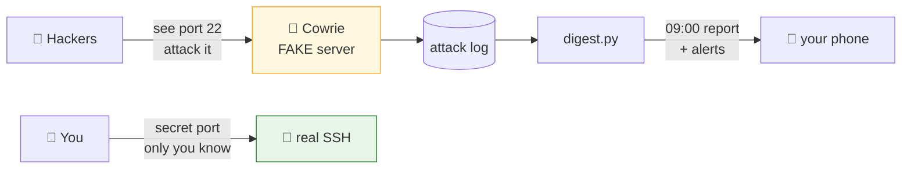
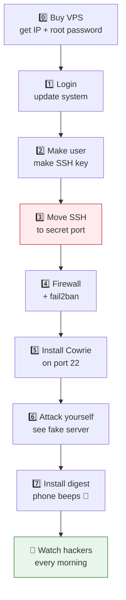

# 🍯 Head First Honeypots

> *Ever wondered what hackers are doing* ***right now?***
> Spoiler: they're knocking on servers like yours. Thousands of times a day.
> This guide turns that around: you'll build a **fake server** they'll attack
> instead — and watch it all from your phone. Copy. Paste. ~1 hour.
> No deep Linux knowledge required. Seriously.



**Here's the trick.** Every server on the internet gets scanned on port 22 —
that's where SSH lives, and bots try passwords there all day long.
We're going to do something sneaky: move your *real* SSH to a secret port
only you know… and put a **trap** on port 22. The trap looks like a real
server, acts like a real server, but records everything and lets the
attacker "win" — while you watch from a safe distance, popcorn in hand. 🍿

---

## 🔥 Fireside chat: Real SSH meets the Honeypot

**Why:** the port swap is the one weird idea in this guide — easiest to "get" as a 20-second dialogue.

*Tonight's discussion: who gets to live on port 22?*

> **Real SSH:** Port 22 is my home. I've always been there.
>
> **Honeypot:** And that's exactly the problem. Every bot on the planet
> knows your address. You get 1,000 uninvited guests a day.
>
> **Real SSH:** …They do keep rattling my doorknob.
>
> **Honeypot:** Move to a secret port. Only your human knows it.
> I'll take port 22, put on your clothes, and let the bots in.
>
> **Real SSH:** You'd do that for me?
>
> **Honeypot:** I'm literally a fake server in a container. Even if they
> "hack" me completely, they've won a sandbox. I'll be taking notes. 📝

---

## The plan

**Why:** see the whole road before walking it. 8 stops, ~1 hour.



### ✏️ Sharpen your pencil

Grab a pen. Write down YOUR two numbers — you'll need them in every step:

| Your thing | This guide uses | **You** use |
|---|---|---|
| Server IP | `203.0.113.10` | ← your real IP |
| Secret SSH port | `51234` | ← yours! 10000–60000 |

> 🚫 **Watch it!** Never publish your real port — not in git, not in
> screenshots, nowhere. A secret door isn't secret once it's on the internet.

---

## 1️⃣ Login. Update.

**Why:** holes in old software = free entry for hackers. Fresh system = closed holes.

On your computer (any terminal works — yes, even Windows PowerShell):

```bash
ssh root@203.0.113.10          # password from your VPS provider
```

You're in! The blinking cursor is your server's. Update it:

```bash
apt update && apt upgrade -y
apt install -y unattended-upgrades sudo
```

That last line teaches your server to patch itself while you sleep. 😴

---

## 2️⃣ User. Key. 🔑

**Why:** bots guess passwords in hours. A key can't be guessed.
And working as root all the time = one typo kills the server.

Think of an SSH key as a 2,000-character password that your computer
remembers so you don't have to. Make one **on your computer** (not the server!):

```bash
ssh-keygen -t ed25519 -f ~/.ssh/honeypot    # press Enter, set a passphrase
cat ~/.ssh/honeypot.pub                     # copy the whole printed line
```

> **Q: Both files look like gibberish. Which one is the key?**
> **A:** Both! `honeypot` is the private key — it never leaves your
> computer, ever. `honeypot.pub` is the public half — that's the one you
> give to the server. The server can verify you hold the private half
> without ever seeing it. Cryptography is neat like that.

Now create your user **on the server**. Pick your own username instead of
`alex`, and paste your public key where it says so:

```bash
useradd -m -s /bin/bash alex && usermod -aG sudo alex
echo 'alex ALL=(ALL) NOPASSWD:ALL' > /etc/sudoers.d/alex && chmod 440 /etc/sudoers.d/alex
mkdir -p /home/alex/.ssh
echo 'PASTE-KEY-HERE' > /home/alex/.ssh/authorized_keys
chmod 700 /home/alex/.ssh && chmod 600 /home/alex/.ssh/authorized_keys
chown -R alex:alex /home/alex/.ssh
```

> **Q: `NOPASSWD`? Isn't that a security hole?**
> **A:** Fair question! In step 3 we disable password login completely —
> after that, `sudo` has no password to ask for. Your key already proved
> who you are when you logged in. This just stops sudo from asking for a
> password that no longer exists.

✅ **Test** — open a **new** terminal tab (keep the old one open, always!):

```bash
ssh -i ~/.ssh/honeypot alex@203.0.113.10 'sudo whoami'   # must say: root
```

Works? You're golden. Fails? Stop and fix it now — everything after this
depends on that key working.

---

## 3️⃣ Move SSH to secret port

**Why:** port 22 must be empty — the trap moves in there.
Your real door hides where nobody scans.

> 🏆 **The one rule of this step:** NEVER close your working session until
> the new one is proven. Every "locked out of my own server" story starts
> with someone skipping this rule.

First, a quick check — Debian 13 starts SSH differently than older systems:

```bash
systemctl is-active ssh.socket ssh.service    # remember which says "active"
```

**If `ssh.socket` said active** (Debian 13):

```bash
systemctl edit ssh.socket
# an editor opens — paste these three lines between the comment markers:
#   [Socket]
#   ListenStream=
#   ListenStream=22
#   ListenStream=51234
systemctl restart ssh.socket
```

**If `ssh.service` said active:**

```bash
cat > /etc/ssh/sshd_config.d/00-hardening.conf <<'EOF'
Port 22
Port 51234
PermitRootLogin no
PasswordAuthentication no
PubkeyAuthentication yes
EOF
sshd -t && systemctl restart ssh
```

Notice what we did: SSH now listens on **both** ports. The old door still
works — we're just trying the new one before demolishing the old.

✅ **Test the new door — new tab:**

```bash
ssh -p 51234 -i ~/.ssh/honeypot alex@203.0.113.10 'echo WORKS'
```

Says `WORKS`? Then close the old door: edit the same file, remove the
`22` line, restart the same way. Now prove the lockout is exactly right:

```bash
ssh root@203.0.113.10                                    # refused ✅
ssh -p 51234 root@203.0.113.10                           # denied ✅
ssh -p 51234 -i ~/.ssh/honeypot alex@203.0.113.10        # works ✅
```

Root can't get in. Passwords can't get in. Only you, only with your key,
only through the secret door. And port 22 sits empty… waiting. 😈

---

## 4️⃣ Firewall. fail2ban. 🧱

**Why:** firewall = wall with exactly two doors (yours and the trap's).
fail2ban = a guard who bans anyone rattling your door too many times.

```bash
ufw default deny incoming && ufw default allow outgoing
ufw allow 51234/tcp comment 'real SSH'
ufw allow 22/tcp comment 'honeypot'
ufw --force enable
```

> 🚫 **Watch it!** The order above is not a suggestion. Enable the
> firewall *before* allowing your SSH port and you'll lock yourself out —
> the classic blunder, right behind "never get involved in a land war in Asia."

```bash
apt install -y fail2ban
cat > /etc/fail2ban/jail.local <<'EOF'
[sshd]
enabled = true
port = 51234
backend = systemd
EOF
systemctl restart fail2ban && fail2ban-client status sshd    # must show the jail
```

---

## 5️⃣ Honeypot time 🍯

**Why:** this IS the trap. A fake server living in a container — even if
hackers "win", they've conquered a sandbox, not your system.

Meet **Cowrie** — a fake SSH server that plays the perfect victim. We run
it in **Podman** (like Docker, but daemonless — fewer privileges, less
attack surface) and let **systemd** babysit it across reboots:

```bash
apt install -y podman fuse-overlayfs slirp4netns

# folders FIRST, owner 999 — or Cowrie crashes. Ask us how we know.
mkdir -p /opt/cowrie/etc /opt/cowrie/var/lib/cowrie/downloads \
         /opt/cowrie/var/lib/cowrie/tty /opt/cowrie/var/log/cowrie
chown -R 999:999 /opt/cowrie/var

# the fake server's name — pick something believable
printf '[honeypot]\nhostname = srv04\n\n[ssh]\nenabled = true\n\n[telnet]\nenabled = false\n' \
  > /opt/cowrie/etc/cowrie.cfg

# passwords the trap accepts (* = any). Without this file, zero catches!
printf 'root:x:*\nadmin:x:*\n' > /opt/cowrie/etc/userdb.txt

# systemd runs the container for us (and restarts it after reboots)
cat > /etc/containers/systemd/cowrie.container <<'EOF'
[Unit]
Description=Cowrie SSH Honeypot

[Container]
Image=docker.io/cowrie/cowrie:latest
ContainerName=cowrie
PublishPort=22:2222
Volume=/opt/cowrie/var:/cowrie/cowrie-git/var:Z
Volume=/opt/cowrie/etc/cowrie.cfg:/cowrie/cowrie-git/etc/cowrie.cfg:ro,Z
Volume=/opt/cowrie/etc/userdb.txt:/cowrie/cowrie-git/etc/userdb.txt:ro,Z

[Service]
Restart=always

[Install]
WantedBy=multi-user.target
EOF

systemctl daemon-reload && systemctl start cowrie.service
sleep 20                                    # first image pull takes a moment
podman logs cowrie 2>&1 | tail -3           # ✅ "Ready to accept SSH connections"
```

One last firewall tweak — without it, the wall silently eats traffic
headed for the container. (This one cost us an entire evening. You're
getting it for free.)

```bash
ufw route allow proto tcp from any to 10.88.0.0/16 port 2222
systemctl restart cowrie.service
```

---

## 6️⃣ Attack yourself 🎣

**Why:** prove the trap works before the real hackers arrive.
Break it now, fix it now — not after a week of empty logs.

The most fun step of the whole guide. From your computer, attack your own
server on port 22 — use *any* password, they're all "correct":

```bash
ssh -o StrictHostKeyChecking=no root@203.0.113.10    # password: anything
whoami && hostname                                    # says: srv04 🤡
```

You just "hacked" a server. Except you didn't — you walked into the trap,
and the trap wrote down everything you did. Check the evidence on the server:

```bash
tail /opt/cowrie/var/log/cowrie/cowrie.json
```

> 🧠 **Brain power:** within minutes of opening port 22, real bots will
> find you. They scan the whole internet constantly — your server was
> already being scanned yesterday; now there's finally something
> interesting answering.

---

## 7️⃣ Phone beeps 📱

**Why:** reading logs by hand = boring, you'll quit in a week.
Your phone taps you on the shoulder when something happens.

Install the digest module — it's this repository:

```bash
apt install -y git
git clone https://github.com/W0nIE/cowrie-digest.git && cd cowrie-digest
./install.sh
```

Now the notification channel. **ntfy** is a free push service — no
account, no sign-up, works in 2 minutes:

1. Install the **ntfy** app on your phone (Android / iOS).
2. Invent a long secret topic name, like `cowrie-alerts-x7k9qm2vdp4w`.
3. In the app: **Add subscription →** your topic, server `https://ntfy.sh`.

> 🚫 **Watch it!** The topic name is the only "password" to your
> notifications — anyone who guesses it can read them. Long and random
> wins here.

Tell the module about it, then test:

```bash
nano /opt/cowrie/ops/01-digest/config.env
# CHANNEL=ntfy
# NTFY_TOPIC=<your secret topic>
# SENSOR_NAME=srv04

/opt/cowrie/ops/01-digest/digest.py --digest    # ✅ phone beeps in seconds
```

That beep means cron is on duty: **full report every morning at 09:00,
instant alerts every 5 minutes.** You never have to look at a log again
(unless you want to — and honestly, you will, they're fascinating).

---

## 🎉 Done. You built a honeypot.

**Why:** a 10-second recap of what you own now — screenshot it for future you.

Let's take stock. You now have:

- 🔐 A server only **you** can enter (key-only, secret port, firewall, fail2ban)
- 🍯 A fake server on port 22, catching real attackers 24/7
- 📱 Morning reports and instant alerts on your phone
- 🍿 A front-row seat to the internet's wild side

Tomorrow morning your phone will show you who visited overnight.
Welcome to honeypot ownership — it's a strangely addictive hobby.
