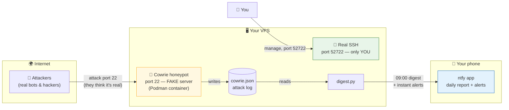
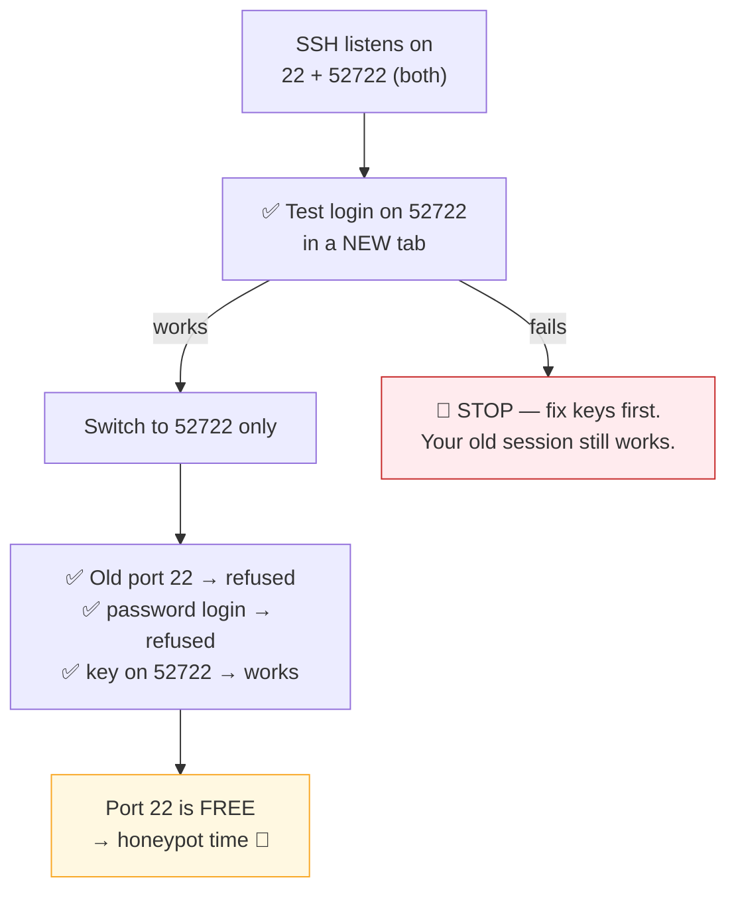
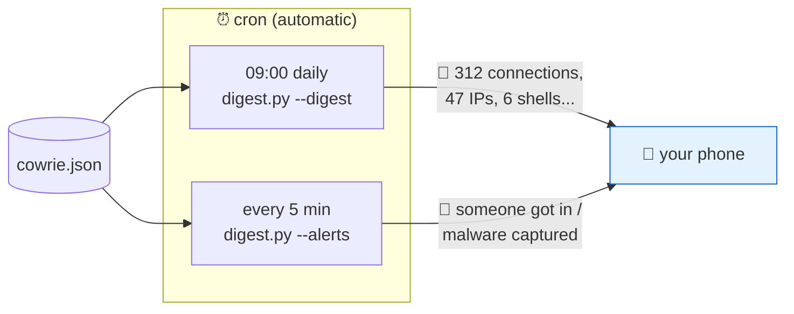

# 🍯 Build Your Own Honeypot Server — Step by Step

> **Who this guide is for:** you have a fresh VPS and want to watch real
> hackers attack a fake server — and get a nice report on your phone every
> morning. No deep Linux knowledge needed: every command is copy-paste,
> every step has a "✅ you should see" checkpoint, and every trap we fell
> into is marked so you won't.

**Time:** ~1 hour. **Cost:** any cheap VPS (~$3–5/mo). **Result:**



**The trick:** attackers scan the internet for open SSH on port 22. Your
*real* SSH hides on port 52722 (only you know it). Port 22 belongs to a
fake server that looks real, logs everything, and lets attackers "in" —
while you watch from a safe distance.

---

## Step 0 — What you need

| Thing | Example | Notes |
|---|---|---|
| A VPS with Debian 12/13 or Ubuntu | any provider | fresh install, root password from provider panel |
| Server IP address | `203.0.113.10` | from provider panel |
| 10 minutes of focus per step | ☕ | — |

Below, replace `203.0.113.10` with **your** server IP everywhere.

---

## Step 1 — First login & update

From your computer's terminal (macOS/Linux) or PowerShell (Windows 10+):

```bash
ssh root@203.0.113.10        # enter the root password from your provider
```

Inside the server, update everything:

```bash
apt update && apt upgrade -y
```

> ⚠️ **If the upgrade fails with a `grub-pc` error** (common on RUVDS and
> some other images), run this once and retry:
> ```bash
> DISK=$(findmnt -n -o SOURCE / | sed 's/[0-9]*$//')
> echo "grub-pc grub-pc/install_devices multiselect $DISK" | debconf-set-selections
> dpkg --configure grub-pc && apt upgrade -y
> ```

Turn on automatic security updates so the server patches itself:

```bash
apt install -y unattended-upgrades
cat > /etc/apt/apt.conf.d/20auto-upgrades <<'EOF'
APT::Periodic::Update-Package-Lists "1";
APT::Periodic::Unattended-Upgrade "1";
APT::Periodic::AutocleanInterval "7";
EOF
```

---

## Step 2 — Your own user + SSH key 🔑

Passwords get brute-forced; keys don't. We'll create a key **on your
computer** (not the server):

```bash
# run on YOUR computer, not the server
ssh-keygen -t ed25519 -f ~/.ssh/honeypot_server   # set a passphrase
cat ~/.ssh/honeypot_server.pub                     # copy the printed line
```

Back **on the server** (still as root), create your user — replace `alex`
with your nickname and paste your public key:

```bash
apt install -y sudo                          # some minimal images lack it!
useradd -m -s /bin/bash alex
usermod -aG sudo alex
echo 'alex ALL=(ALL) NOPASSWD:ALL' > /etc/sudoers.d/alex
chmod 440 /etc/sudoers.d/alex

mkdir -p /home/alex/.ssh
echo 'PASTE-YOUR-PUBLIC-KEY-HERE' > /home/alex/.ssh/authorized_keys
chmod 700 /home/alex/.ssh
chmod 600 /home/alex/.ssh/authorized_keys
chown -R alex:alex /home/alex/.ssh
```

> Why `NOPASSWD` for sudo? In the next step we disable password login
> completely — after that sudo has no password to ask for. The key is your
> identity now.

✅ **Checkpoint** — open a **new** terminal tab (keep the old one open!):

```bash
ssh -i ~/.ssh/honeypot_server alex@203.0.113.10 'sudo whoami'
# must print: root
```

Only continue when this works.

---

## Step 3 — Move SSH to a secret port

This is the heart of the trick. We move your real SSH from port 22 to
**52722** (pick your own number 10000–60000), so port 22 becomes free for
the honeypot.



**The golden rule of this step:** never close your working session until
the new one is proven. We follow this order strictly.

**3a.** Check how SSH is started (Debian 13 uses socket activation):

```bash
systemctl is-active ssh.socket ssh.service
```

**3b.** Create the config — we keep **both ports** for now.

If `ssh.socket` said **active**:

```bash
systemctl edit ssh.socket
# paste between the comment markers:
#   [Socket]
#   ListenStream=
#   ListenStream=22
#   ListenStream=52722
systemctl restart ssh.socket
```

If `ssh.service` said **active**:

```bash
cat > /etc/ssh/sshd_config.d/00-hardening.conf <<'EOF'
Port 22
Port 52722
PermitRootLogin no
PasswordAuthentication no
PubkeyAuthentication yes
EOF
sshd -t && systemctl restart ssh
```

**3c.** ✅ **Checkpoint** — in a **new** tab:

```bash
ssh -p 52722 -i ~/.ssh/honeypot_server alex@203.0.113.10 'echo NEW PORT WORKS'
```

**3d.** Only if that printed `NEW PORT WORKS` — drop port 22 (edit the
same file/socket drop-in, remove the `22` line, restart again) and verify
the lockout is correct:

```bash
# from your computer:
ssh     root@203.0.113.10                         # → Connection refused ✅
ssh -p 52722 root@203.0.113.10                    # → Permission denied ✅
ssh -p 52722 -i ~/.ssh/honeypot_server alex@203.0.113.10  # → works ✅
```

📌 **Write down your new connection string. The key file
`~/.ssh/honeypot_server` is now the ONLY way in. Back it up.**

---

## Step 4 — Firewall + fail2ban 🧱

```bash
ufw default deny incoming
ufw default allow outgoing
ufw allow 52722/tcp comment 'real SSH'
ufw allow 22/tcp comment 'honeypot (soon)'
ufw --force enable
```

> ⚠️ The order matters: allow your SSH port **before** enabling, or you
> lock yourself out.

fail2ban bans IPs that keep failing passwords on your *real* SSH:

```bash
apt install -y fail2ban
cat > /etc/fail2ban/jail.local <<'EOF'
[sshd]
enabled = true
port = 52722
backend = systemd
EOF
systemctl restart fail2ban
fail2ban-client status sshd        # ✅ must show the jail, not an error
```

---

## Step 5 — The honeypot 🍯 (Cowrie in Podman)

We run Cowrie in **Podman** (a safer Docker alternative: daemonless,
drops fewer privileges) with **systemd** keeping it alive across reboots.

**5a.** Install Podman and prepare folders:

```bash
apt install -y podman fuse-overlayfs slirp4netns

mkdir -p /opt/cowrie/etc /opt/cowrie/data
mkdir -p /opt/cowrie/var/lib/cowrie/downloads /opt/cowrie/var/lib/cowrie/tty /opt/cowrie/var/log/cowrie
chown -R 999:999 /opt/cowrie/var
```

> 🪤 **Trap we hit:** Cowrie inside the container runs as **UID 999**, and
> an empty/mis-owned volume makes it crash with
> `FileNotFoundError: var/lib/cowrie/ssh_host_rsa_key.pub`. The two lines
> above prevent both.

**5b.** Minimal config — the fake server's name is `srv04` (pick your own
believable name):

```bash
cat > /opt/cowrie/etc/cowrie.cfg <<'EOF'
[honeypot]
hostname = srv04

[ssh]
enabled = true

[telnet]
enabled = false
EOF
```

**5c.** Passwords the honeypot accepts — `*` means "any password works"
(fine to start; see *Going further* for the realistic-auth upgrade):

```bash
cat > /opt/cowrie/etc/userdb.txt <<'EOF'
root:x:*
admin:x:*
EOF
```

> 🪤 **Trap:** the official image ships **no** userdb — without this file
> every login fails and your honeypot catches nothing.

**5d.** The quadlet — systemd runs the container for us:

```bash
cat > /etc/containers/systemd/cowrie.container <<'EOF'
[Unit]
Description=Cowrie SSH Honeypot

[Container]
Image=docker.io/cowrie/cowrie:latest
ContainerName=cowrie
PublishPort=22:2222
Volume=/opt/cowrie/var:/cowrie/cowrie-git/var:Z
Volume=/opt/cowrie/etc/cowrie.cfg:/cowrie/cowrie-git/etc/cowrie.cfg:ro,Z
Volume=/opt/cowrie/etc/userdb.txt:/cowrie/cowrie-git/etc/userdb.txt:ro,Z

[Service]
Restart=always

[Install]
WantedBy=multi-user.target
EOF

systemctl daemon-reload
systemctl start cowrie.service
sleep 20                                 # first image pull takes a moment
podman logs cowrie 2>&1 | tail -3
```

✅ **Checkpoint:** the log must say `Ready to accept SSH connections`.

**5e.** One firewall fix (this one cost us an evening):

```bash
ufw route allow proto tcp from any to 10.88.0.0/16 port 2222
systemctl restart cowrie.service
```

> 🪤 **Trap:** UFW's default policy silently drops traffic *forwarded* to
> containers (it arrives at the container port 2222, not 22). The `route
> allow` rule fixes it. And because touching UFW reloads firewall rules,
> restart the container right after.

**5f.** ✅ **Attack yourself** (the fun part) — from your computer:

```bash
ssh -o StrictHostKeyChecking=no root@203.0.113.10   # password: anything
whoami && hostname
```

You should "log in" and see `srv04` — but it's the fake. Meanwhile the
real server logged everything. 🎣

Within minutes of opening port 22, real bots from the internet will find
you. Their attacks land in `/opt/cowrie/var/log/cowrie/cowrie.json`.

---

## Step 6 — Reports to your phone 📱 (this repo)

Now install the digest module — it's this repository:

```bash
apt install -y git
git clone https://github.com/W0nIE/cowrie-digest.git
cd cowrie-digest
./install.sh                       # run as root (sudo -i first)
```

Get notified via **ntfy** (free, no account, 2 minutes):

1. Install the **ntfy** app on your phone (Android / iOS).
2. Invent a long secret topic name, e.g. `cowrie-alerts-x7k9qm2vdp4w`.
3. In the app: **Add subscription →** that topic, server `https://ntfy.sh`.
4. On the server:

```bash
nano /opt/cowrie/ops/01-digest/config.env
# set:
#   CHANNEL=ntfy
#   NTFY_TOPIC=cowrie-alerts-x7k9qm2vdp4w   ← your topic
#   SENSOR_NAME=srv04

/opt/cowrie/ops/01-digest/digest.py --digest    # ✅ test: push arrives in seconds
```

Done — cron is already installed:



Other channels (Telegram) and all settings: [docs/CONFIGURATION.md](CONFIGURATION.md).

---

## Troubleshooting (real traps, real fixes)

| Symptom | Cause | Fix |
|---|---|---|
| Container crashes: `ssh_host_rsa_key.pub` not found | empty host volume masked the image's `var/` | create the `var/...` dirs from step 5a **before** starting |
| `PermissionError` in cowrie logs | host dirs owned by root | `chown -R 999:999 /opt/cowrie/var` |
| Every login fails, zero events | missing `userdb.txt` | step 5c, then `systemctl restart cowrie.service` |
| Self-attack: connection times out | UFW drops forwarded container traffic | the `ufw route allow ... 2222` rule from step 5e |
| Honeypot died after editing UFW | UFW reload wipes container firewall jumps | `systemctl restart cowrie.service` after any `ufw` change |
| `Permission denied` on port 52722 | wrong key / user | use `-i ~/.ssh/honeypot_server` and your username, not root |
| `Port` in sshd_config ignored | Debian 13 socket activation | set the port via `systemctl edit ssh.socket` (step 3b) |
| Need to peek inside the container | image has no `cat`/`grep`/`sh` | `podman exec cowrie python3 -c "print(open('/etc/hostname').read())"` |

---

## Going further (optional levels)

You have a working, reporting honeypot. When you're ready for upgrades:

1. **Realistic auth** — replace wildcard passwords with believable weak
   ones so you catch targeted attackers, not just botnet noise:
   [07-auth-realism](../07-auth-realism/README.md).
2. **Deception filesystem** — make the fake server look like a real lived-in
   web server (fake WordPress, bash history, backups). Advanced; ask in
   issues.
3. **Privacy** — attacker IPs are personal data under GDPR/152-ФЗ. This
   repo already pseudonymizes them in reports; read the plain-language
   policy: [docs/PII-PROCESSING.md](PII-PROCESSING.md).

## Safety notes ⚠️

- A honeypot is a **deliberately attacked** machine. Give it its own VPS;
  don't host anything you care about next to it.
- Never reuse the honeypot's bait passwords anywhere real.
- The key to port 52722 is the only way in — back it up like a passport.

---

*Built and verified on a real RUVDS server (Debian 13) — every command and
every trap above comes from an actual deployment, not theory.*
