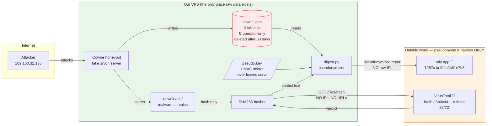

# How we handle personal data (PII) 🛡️

> **TL;DR:** Our honeypot watches attackers. Attackers have IP addresses, and an
> IP address counts as personal data under Russian law (152-ФЗ) and GDPR.
> So we follow one golden rule: **raw data never leaves our server.**
> Everything we send out is pseudonymized or aggregated. This page explains
> what we collect, why, and how we keep it safe — in plain language.

---

## 1. What we collect (and why)

Our server runs a **honeypot** — a fake server that attracts attackers so we
can study them and improve our defenses. When someone attacks it, we record:

| Data | Example | Is it personal data? | Why we need it |
|------|---------|---------------------|----------------|
| Attacker IP address | `109.160.32.136` | ✅ **Yes** | Know who's attacking, count repeat offenders |
| Passwords they try | `root` / `123456` | ⚠️ Potentially (could be someone's real password) | Understand attacker techniques |
| Commands they run | `wget http://...` | ⚠️ Potentially (may contain URLs/keys) | Understand their goals |
| Files they upload | malware samples | ❌ No (it's *their* malware) | Identify threats |
| File hashes | `e3b0c44…` | ❌ No | Look up threats on VirusTotal |

**Our legal basis:** protecting your own infrastructure is a legitimate
interest (GDPR Recital 49 explicitly names network & information security).
We collect only what attacks us, nothing else. We don't seek out or buy any
data about anyone.

## 2. The golden rule 🔑

```
┌─────────────────────────────────────────────────────┐
│  RAW data lives on our server. Period.              │
│  Only PSEUDONYMS and AGGREGATES ever leave it.      │
└─────────────────────────────────────────────────────┘
```

- Attacker IPs in reports are replaced with **pseudonyms** like
  `ip-9f4a2c81e7b3` (HMAC-SHA256 with a secret key that never leaves the
  server — the same attacker always gets the same pseudonym, so our
  statistics still work).
- VirusTotal receives **only file hashes** (64 hex characters). Never IPs,
  never URLs, never log lines.
- Our notification channel (ntfy) receives **only pseudonymized reports**.

## 3. Data flow



## 4. How long we keep things

| Data | Retention |
|------|-----------|
| Raw logs (`cowrie.json`, session recordings) | **60 days**, then deleted |
| Pseudonymized reports & statistics | Indefinitely (no personal data in them) |
| Malware samples | Indefinitely (not personal data) |
| HMAC secret key | Until rotated (rotation = old pseudonyms stop matching, that's fine) |

## 5. Who can see the raw data

- **Only the server operator** (the VPS owner). Raw logs are locked down
  (`root`-only file permissions).
- No employees, no third parties, no public access. Ever.
- The ntfy topic name is kept secret — it's the only "password" to our
  outgoing (already pseudonymized) notifications.

## 6. Third parties we touch

| Service | What it receives | Contains personal data? |
|---------|------------------|------------------------|
| **ntfy.sh** (notifications) | Pseudonymized reports | ❌ No raw IPs |
| **VirusTotal** | File SHA256 hashes only | ❌ No |
| **Telegram** | Nothing — unused (blocked by our hoster anyway) | ❌ No |

## 7. The controls (for the curious engineer)

This isn't just promises — each safeguard is a tracked, tested piece of work:

| Control | Where it lives |
|---------|---------------|
| IP pseudonymization (HMAC-SHA256) in all outbound reports | [issue #8](../../issues/8) |
| Raw-log retention ≤ 60 days | [issue #9](../../issues/9) |
| Operator-only access to raw logs | [issue #10](../../issues/10) |
| This policy + technical compliance docs | [issue #11](../../issues/11) |
| Roskomnadzor notification (152-ФЗ) | [issue #12](../../issues/12) |
| VirusTotal = hash-only by design | [issue #3](../../issues/3) |

## 8. Questions / requests

This is a personal security-research project. If you believe your data
appears in our logs and want it checked or removed, open an issue in this
repository (please **don't** include any personal data in the issue itself).

---

> 🇷🇺 **Коротко по-русски:** IP-адреса атакующих — это персональные данные
> (152-ФЗ). Поэтому сырые логи хранятся только на нашем сервере (доступ —
> только у оператора, удаление через 60 дней), а наружу уходят лишь
> обезличенные данные: псевдонимы вида `ip-9f4a2c81e7b3` (HMAC-SHA256, ключ
> не покидает сервер) и хэши файлов для VirusTotal. Цель обработки —
> информационная безопасность и исследование угроз (legitimate interest).
